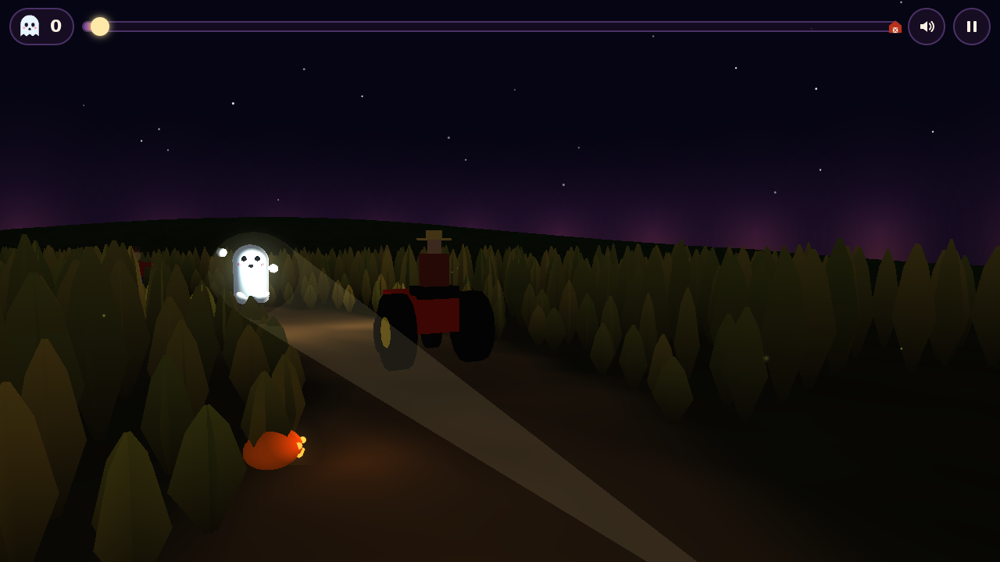
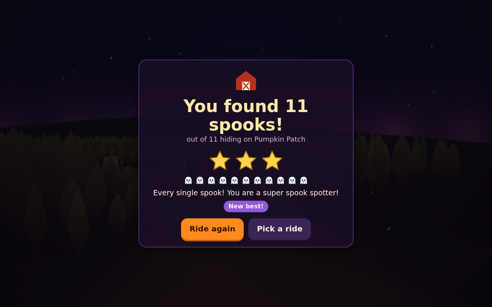

# Haunted Hayride



A gentle Halloween game for little ones. You ride a hay wagon along a winding
road through a cornfield at night. Friendly spooks peek out of the stalks,
from behind the scarecrows and over the pumpkins. Shine your flashlight on
them before they duck away. Each one you find waves, giggles and pops. The
ride ends back at the barn with a score card: "You found 14 spooks!"

Nothing is scary: no jump scares, no losing, no timer to beat. A ride lasts
about one and a half to two and a half minutes.

**Play it in a browser:** https://haunted-hayride.play.danielstephenson.dev
(desktop and phone).

## How to play

- **Mouse:** move the mouse to point the flashlight. Keep the light on a spook
  for a moment, and it is found.
- **Touch:** touch the screen where you want the light, or drag your finger
  across it.
- Esc pauses the ride and M turns the sound on or off. Both have buttons at the
  top of the screen too.

There are three rides:

| Ride | Length | What hides there |
|---|---|---|
| Pumpkin Patch | about 1.5 minutes | mostly pumpkins; slow and easy |
| Scarecrow Lane | about 2 minutes | tall corn and scarecrows |
| Moonlight Maze | about 2.5 minutes | a twisting road with lots of spooks |

There are four kinds of spook: ghosts, black cats, pumpkin-headed jacks and
bats. Each ride remembers its best score in your browser.



## How it is made

The game is C++17 on the [Strata](https://github.com/Preponderous-Software/strata)
engine (v0.7.0), built for the browser with Emscripten and Strata's WebGL 2
backend.

- `src/ride/`: the ride itself. This covers the road (a smooth closed loop),
  the hiding places, how each spook peeks and ducks, and the flashlight's
  catch test. It is plain arithmetic with no engine, so it is tested on its own
  (`tests/test_ride.cpp`). It is deterministic: the same ride plays out the
  same way every time.
- `src/view/`: what you see. This covers the field, the corn (crossed leafy
  cards in chunks), the barn, the scarecrows, the wagon and the tractor that
  pulls it. Each frame it also draws the spooks out of Strata's primitives,
  the beam (a translucent cone) and its pool of light, the candles, the stars
  and the confetti.
- `app/web_main.cpp`: the browser entry point and the page hooks.
- `web/shell.html`: the menus, the HUD, the score card and all the sound. Every
  sound is synthesized with Web Audio (no recordings): crickets, wind, the
  tractor's putt-putt, a bouncy tune, and a peek, giggle and pop for each kind
  of spook.

### Build and test

The ride's tests need only a C++17 compiler and CMake 3.20 or newer:

```sh
cmake -S . -B build
cmake --build build
ctest --test-dir build --output-on-failure
```

For the browser game, use emsdk 6.0.11 (Strata's pin):

```sh
emcmake cmake -S . -B build-web -DHAYRIDE_WEB=ON
cmake --build build-web
# serve build-web/haunted-hayride.html with its .js and .wasm
```

CI (`.github/workflows/browser.yml`) builds the page and runs the tests as wasm
under Node. It then smoke-tests the page in headless Chromium on a desktop
profile and an iPhone 13 profile (`web/smoke/smoke.cjs`): it starts a ride,
catches a spook with the real mouse or touch input, and rides to the score
card. On `main` it deploys to the arcade.

## Licence

MIT. See [LICENSE](LICENSE).

_drafted by Claude on behalf of Daniel Stephenson_
